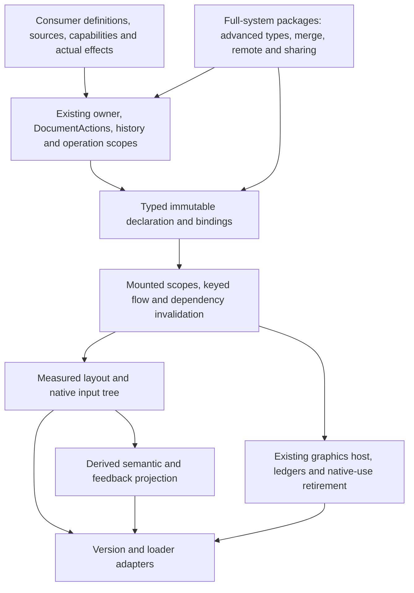

# Semantic interaction architecture

This is a design contract, not an implemented API or a runtime qualification claim. It revises the next unpublished 0.4 design and defines a connected full-system reference architecture. The completed dev.96/Styled31 cohort remains an immutable historical baseline. No product implementation, candidate binary, consumer migration, or publication is selected by this design effort.

The objective is a native configuration and task toolkit whose authored structure, interaction, visual state, narration, and effects agree. SwiftUI informs authoring; Solid 2 informs owned flow and updates; Base UI informs intrinsic component behavior; Playground supplies a concrete retained composition precedent. [Research and decisions](research.md) identifies exact sources and deliberate differences. No upstream UI runtime becomes a dependency.

## Two designs and one foundation

**Design A: revised 0.4.** Implement the kernel contracts needed by the current forms, embedded reference picker, Profiles audition, factored preview controls, retained camera, automatic bounded search/preparation, accessible disclosure, and stable text breadcrumb/history header. Existing codecs, owner sessions, operations, and renderer lifetimes remain authoritative. [References and previews](references-previews.md) defines the user journeys and [migration](migration.md) defines the actual replacement seams.

**Design B: full reference.** Extend the same kernel through the complete value/editor families, cross-document derivation/inheritance, expressions, typed merge, advanced bindings/references, matching-definition remote administration, sharing, and external extension contracts. These are named packages in [full-system architecture](full-system.md), not an undifferentiated Phase 2 or automatically activated implementation.

Both designs use the same meaning of identity, state, actions, layout, focus, availability, operations, and retirement. Design A does not contain placeholder implementations of Design B. Design B names its additional inputs, policies, failure cases, limits, and qualification; it does not replace the foundations later.

## Framework and library adoption

Support two first-class adoption styles over these same services. Framework consumers let re:form orchestrate the admitted UI/editor/task lifecycle, navigation, retention, and cleanup while actual domain owners retain values, permissions, persistence, and effects. Lootr-styled and the selected Compat integration use this framework path. Selective library consumers borrow only needed components/services and supply their actual host/mount/thread/lifetime boundary, without dummy documents, a mandatory workspace, or unrelated capabilities.

Capabilities are optional to adopt, not optional to implement when included in the selected delivery scope. Every selected capability retains its accessibility, authority, currentness, resource, and cleanup contracts. Framework adoption does not activate every optional feature. A service may require its genuine dependencies, but must not depend on the whole workflow merely to obtain a lifetime. The [state/lifetime foundation](../../development/scoped-state.md) is implemented first; external native component mounting and complete selective-use journeys still require their own implementation and qualification.

## Reading and contract ownership

| Document                                          | Owns                                                                                                                                                 |
| ------------------------------------------------- | ---------------------------------------------------------------------------------------------------------------------------------------------------- |
| [Research and decisions](research.md)             | Version/source identity, applicability, adopted/adapted/rejected ideas, alternatives, and design decisions.                                          |
| [Kernel](kernel.md)                               | Vocabulary, identities, declaration/mount/state lifetimes, dependencies, flow control, scheduling, environment, modifiers, module and ownership map. |
| [Layout and interaction](layout-interaction.md)   | Geometry algorithms, semantic projection, input/focus/overlays, component behavior, accessibility and native adapters.                               |
| [References and previews](references-previews.md) | Shared picker/controller, search/completion, actual draft staging versus audition, subject controls, preview triggers, camera and retirement.        |
| [Owner workflows and full system](full-system.md) | Existing owner integration, complete capability inventory, future packages and their contracts, remote/merge/expression/security boundaries.         |
| [Proposed APIs](api.md)                           | Design-level Java shape, typed bindings, results, state/actions, builders, component parts, and extension admission.                                 |
| [Authoring examples](examples.md)                 | Seven connected usage examples and their exact state/effect/event sequences.                                                                         |
| [Migration and delivery plan](migration.md)       | Kept/evolved/replaced/retired map, source seams, dependency-ordered packages, checkpoints, intent lineage and update responsibilities.               |
| [Acceptance and design audit](acceptance.md)      | Objective and inherited-requirement traceability, adversarial walkthroughs, design checks and future implementation qualification.                   |

Implemented contracts remain in the [development references](../../development/README.md); the older [presentation contract](../presentation-0.4.md) and its 38-case matrix remain the baseline wherever this design does not explicitly replace behavior. New class names and code examples here are proposed and unavailable in dev.96. They do not claim compilation. An implementation must preserve the relevant public compatibility or document a deliberate migration before issuing a new immutable candidate.

## System map

This graph shows service dependencies, not a new save path. Native input dispatches admitted semantic commands into existing services. Renderer extraction consumes frozen geometry/content and leases, not live editor state. No layout, semantic readback, paint, or narration callback may invoke domain compilation, source IO, persistence, application, or world work.

## Scope and completion meaning

The supported implementation target remains Minecraft 1.21.1/Java 21 and 26.3/Java 25, each on Fabric and NeoForge. Native fonts, GUI scaling, serializers, callbacks, world contexts, and authority stay with their actual owners. Core stays game-independent. The full design is bounded to configuration, authoring, inspection and owner-backed tasks; a browser, arbitrary gameplay RPC engine, general OS application framework, CSS evaluator, global mod-job scheduler, or game renderer is outside it.

Design completion means implementable contracts with requirement lineage, failure/lifetime rules, examples, migration, and meaningful acceptance. It does not mean the proposed behavior is implemented, natively tested, aesthetically accepted, published, or available in an existing artifact. Native/spoken accessibility, IME, GPU presentation, remote transport and performance claims require their own eventual observations.
