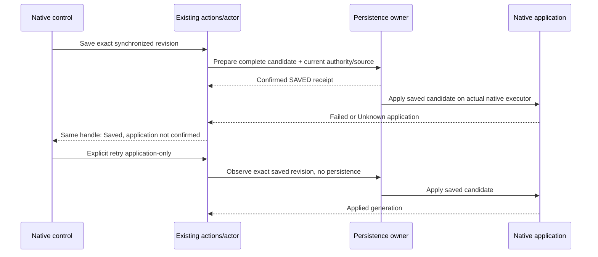

# Owner workflows and the full reference architecture

Design B completes the intended configuration/authoring/task domain over the same [kernel](kernel.md). Its packages below replace Phase 2 as a planning bucket. They are designed future work, not implemented adapters, selected runtime dependencies, remote authority, or an activation of other saved intents.

## Existing owner/effect system remains the foundation

`DocumentActions`, `EditorActor`, `DocumentSession`, `OwnerContext`, typed definitions/codecs and existing OperationScope/Handle remain the service boundary for GUI, commands, and later remote entry. One document has its actual retained draft/history/save lane. A section, alias, view state, preview or remote presentation does not create another persistence owner.

Before editing, the frontend synchronizes native raw input and captures the actual target/input epoch. Before submission, complete validation and real owner admission run on their declared executor; native foreign callbacks are not moved to arbitrary workers. Confirmation/review binds an exact submitted revision; later edits remain separate and acknowledgement preserves them. File/native serializers keep unknown keys/comments/no-op/external-conflict semantics and actual application timing.

| Observation                           | Meaning                                                                | Allowed recovery                                                                                                           |
| ------------------------------------- | ---------------------------------------------------------------------- | -------------------------------------------------------------------------------------------------------------------------- |
| Edited/valid or invalid draft         | Session state, no file/runtime claim.                                  | Repair, Undo/Redo, explicit defaults/revert, inspect and admitted preview.                                                 |
| Saved + Applied                       | Exact persistence receipt and actual application acknowledgement.      | Inspect the same result; later edits are not included.                                                                     |
| Saved + Failed/Refused application    | File/source update is confirmed; runtime did not confirm use.          | Apply/reload saved revision through supported application-only path; never repeat Save merely to recover application.      |
| Unknown persistence                   | A write may have happened; acknowledgement unavailable.                | Reconcile actual source under fresh authority; no blind retry.                                                             |
| Saved + Unknown/Cancelled application | Entered work may have applied despite cancellation.                    | Observe current generation/state; explicit supported application-only retry if still needed. Cancellation is not rollback. |
| Batch partial                         | Earlier owners have real receipts; later owner failed/refused/unknown. | Retain each receipt and source observation; reconcile/review remaining work. No invented multi-file transaction.           |

Dirty Reload saved, manual conflict resolution, import Preview/Stage, submission review, dirty-close and operation results retain their exact existing services. Defaults/Undo/Redo act on the complete owner, including hidden fields. Import is an admitted bounded source plus format, comparison and explicit draft staging, never a URL/file writer chosen by a widget. Close distinguishes leaving a borrowed view from workflow closure and entered work drain. Home remains lazy even when the original saved source is malformed/unavailable.

Event order for a successful save with failed application:



A UI `Errored` boundary can render failure context but cannot alter this receipt. An observer exception after save does not establish rollback. Owner liveness/READ projections clear disclosed information after revocation while underlying entered receipts continue to drain independently.

## Full value and editor inventory

The original complete-system families remain obligations. Existing services are retained and extended where needed; this table does not infer current native qualification from a type's presence.

| Family                        | Complete contract                                                                                                                                                          | Additional full-package work                                                                       |
| ----------------------------- | -------------------------------------------------------------------------------------------------------------------------------------------------------------------------- | -------------------------------------------------------------------------------------------------- |
| Scalars/text                  | Boolean and integer widths, float/double, exact boundaries/precision, strings/multiline/specialized strings; incomplete/invalid/raw versus accepted typed values distinct. | F01 specialized string/multiline policies and native input support where absent.                   |
| Choices/defaults              | Stable enum/non-enum values, single/multiple, explicit omission/default/inherited/explicit states; labels never change codecs.                                             | F01 richer choice controls using shared list/selection semantics.                                  |
| Collections                   | Recursive List/Set/Map with typed keys/values, stable draft rows, order/duplicate diagnostics, bounded depth/counts.                                                       | F01 complete nested editors, structural operations and qualified identity policy.                  |
| Structures                    | Records, pairs, reusable nesting, optionals/null policy, tagged alternatives and whole/cross-field validation.                                                             | F01 recursive editor composition; inactive alternatives retain values without fabricated validity. |
| Native references/ingredients | Exact registry/resource keys, entries, tags, ingredients/alternatives with context-bound resolution and absent/unsupported outcomes.                                       | F02 typed selector and native codec/resolution adapters; no live context inside workers.           |
| Colors                        | Declared RGB/RGBA/alpha storage, numeric/hex entry and synchronized read-only display.                                                                                     | F01 color component/formatter/codec policies below.                                                |
| Bindings                      | Existing keyboard/mouse/modifier/native option ownership; alternatives/chords only with a declared capable owner.                                                          | F02 alternative/chord editing, capture/conflict model and optional owner adapter.                  |
| Expressions                   | Parsed deterministic math with declared scalar variables/functions and complete input/evaluation/output bounds.                                                            | F04 expression policy/adapter; not a layout/effect scripting language.                             |
| Mapped/domain values          | Bidirectional conversion, exact units/duration/distance/probability, sentinel captions, inclusive/exclusive domains.                                                       | Existing numeric contract retained; F01 only genuinely missing mappings/editors.                   |
| Actions/status/help           | Read-only meaningful facts, documentation links and typed operations, not fake persisted fields.                                                                           | Kernel components + F06 richer retained operation/help projections as justified.                   |

For every family, design and implementation must cover codecs/freeze/equality, raw editing, constraints, complete validation, defaults/history, source/application context, command representation, narration, limits and external extension. Illegal combinations refuse with a path; unsupported is distinct from missing value. Presentation cannot clamp a legitimate number, erase custom references, coerce unset to false, reinterpret a sentinel, or drop a hidden tagged branch merely because a default control is simpler.

## Named future packages

| Package                                            | Depends on                                                                                       | Public responsibility and boundary                                                                                            | Implementation completion gate                                                                                                       |
| -------------------------------------------------- | ------------------------------------------------------------------------------------------------ | ----------------------------------------------------------------------------------------------------------------------------- | ------------------------------------------------------------------------------------------------------------------------------------ |
| F01: complete value editors                        | A kernel/components + existing value/edit codecs.                                                | Typed color/multiline/recursive/mapped/default editor contributions through restricted bindings.                              | All families and supported nesting exercise invalid/history/codec/native semantics through external packaged examples.               |
| F02: specialized references and bindings           | A picker/completion + actual native context/capability owners.                                   | Ingredients, alternatives, advanced keys/chords and native conflict/capture adapters.                                         | Actual native codec/key owner persistence, source loss/capture precedence, unsupported/minimum/absent-provider cases.                |
| F03: derivation, inheritance and typed merge       | Existing observations/conflicts + kernel pure projections.                                       | Explicit cross-document DAG, provenance and owner-qualified structural merge proposals.                                       | Cycle/stale/permission/concurrent-change cases, source-qualified row identity, whole-candidate validation; no hidden write.          |
| F04: bounded expression values                     | Existing numeric/type validation + F03 declared inputs where required.                           | Pure deterministic expression parse/evaluate/diagnostics with private restricted provider.                                    | Adversarial parse/precision/operation/output bounds and concurrency; exact result/error/codec equivalence; no IO or effect language. |
| F05: authenticated remote views/admin              | Existing owner/operation commands + F01/F02 registered matching schemas + F07 bounds/provenance. | Capability negotiation, policy-filtered snapshots and typed proposals/results/cancel under actual peer contexts.              | Real integrated/dedicated/LAN/two-session absence/mismatch/revoke/reconnect/oversize/unknown and no-replay evidence.                 |
| F06: explicit sharing and rich task/help surfaces  | Existing import/export + F05 only for remote transfers.                                          | Reviewed portable projections, recipient validation, retained result/help/operation composition.                              | Private-field filtering, source/schema/version checks, explicit Stage/Save/Apply and no cross-context replay.                        |
| F07: tooling and extension SDK                     | A kernel diagnostics/inspection and existing artifact tooling.                                   | Bounded semantic/layout/operation inspectors, contract fixtures, author examples, capability/version manifest and provenance. | Actual public artifact extensions and redacted read-only inspection; no private class access or effect bypass.                       |
| F08: consumer/cohort qualification and maintenance | Applicable A/F packages and actual consumer owners.                                              | Affected Compat/Skyweave/other adoption, independent fixtures, full-pack/side/cost/update coverage at selected scope.         | Each actual selected consumer and combined cohort qualified, schemas/paths/effects retained, immutable final local handoff.          |

F05 may use existing scalar/reference controls before all F01/F02 specialties ship, but cannot advertise an unsupported schema/control capability. F07's basic diagnostics exist in A; its full extension/cohort tools can evolve incrementally. These dependencies are capability requirements, not an instruction to hold all useful work until every future package finishes.

## F01/F02 editor and extension protocol

A `ValueEditorFactory<V>` registers an exact admitted ValueType or declared field selector, label/description/part contract, parse/format policy, raw-state snapshot type, semantic control role, native capabilities, limits and disposal. Registration checks duplicate precedence and conflicts before owner entry. The editor receives a restricted field binding, not arbitrary JSON/files. Failed native factory construction releases its partial view and leaves the existing owner/draft available.

Colors declare byte/integer/float/string encoding, allowed channel domains, alpha presence, and whether display values are sRGB or linear. The owner retains that encoding; a visual swatch cannot quantize floats into bytes or invent absent alpha. Numeric/hex edits converge through one typed parser/formatter, retain invalid text and report channel/path issues. Display gamut limitations are disclosed separately from validation. Color selection never changes a gameplay shader outside the owner effect.

Ingredient selectors use the actual native codec and immutable resolution context for item/tag/alternative structures. Suggestions do not define the legal authored domain. Capture bounded source data on the required native executor, perform pure work on frozen values, and recheck registry/resource epoch before publication. Arbitrary NBT/components, live stack mutation and uncontrolled native predicates remain outside generic workers.

Advanced binding definitions contain device kind, physical/logical key identity as supplied by the actual owner, modifiers, sequence/alternative policy, conflict context and native capture status. Capture is a scoped transient input mode; Escape/click/IME ownership is explicit and gameplay cannot receive captured activation. Store changes only through the existing native or explicitly registered domain key owner. If that owner cannot support alternatives/chords, expose unsupported with reason; do not create a shadow JSON assignment or intercept all game input. Conflicts are facts from capable owners, not inferred mutual exclusion from UI categories.

## F03 derivation, inheritance, and structural merge

Declare dependency edges `(source document/field, observation kind, context epoch, projection version)` and a pure typed derivation with known bounded inputs. Topologically evaluate demanded values from cached immutable observations. Missing/private/stale inputs yield explicit unavailable/unknown, not default fallback. Cycles return a path diagnostic. Cross-document runtime compilation consumes published immutable results; it never walks widget graphs. Inheritance layers have owner-declared precedence and provenance; no universal guessed resource/file precedence is introduced.

Derived values are read-only by default. An editable override is an explicit optional field in the actual definition, retaining omitted versus explicit state and normal history. A view-local audition is not an inheritance layer or a persisted override. Changing a dependency invalidates the projection/candidate, not silently writes its dependent field. Any coupled edit is a named compound owner action.

Typed merge input is baseline B, freshly observed saved S, and draft D with exact owner/schema/source identities. For each owner-qualified stable field: if D equals B, use S; if S equals B, use D; if D equals S, use that value; otherwise produce an explicit conflict. Equality preserves authored distinctions where the owner requires them. Recursively merge only types whose identity policy is explicitly admitted. A list/map collection with no persistent source-qualified element identity is a whole-field conflict; editor row UUIDs or array indices do not prove cross-file identity.

The result is `MergeProposal` with candidate/alternatives, provenance and expected saved revision, never a committed file. Revalidate the complete candidate and stage through the existing conflict-resolution/rebase service, retaining that service's actual history-reset policy. A further external edit invalidates the proposal; no retry overwrites it. Partial/unknown write outcomes remain ordinary owner receipts. No text merge, hidden default correction, rollback or cross-process transaction is implied.

## F04 expression contract

`ExpressionPolicy` declares operators/functions/typed scalar variables, numeric MathContext/rounding, locale-independent grammar, deterministic evaluation, permitted result domain and explicit bounds: input bytes, tokens, nesting, AST nodes, arguments, literal precision/scale/magnitude, operation cost and expanded output. The inherited initial arithmetic set is +, -, *, /, %, unary signs, parentheses and ABS/MIN/MAX. Exponentiation/additional functions need a separately qualified policy. Time, randomness, regex, recursive/structured expression values and arbitrary native/world/IO callbacks are excluded by default.

The selected historical private EvalEx direction is retained as an adapter candidate, with no EvalEx class in public signatures. Revalidate the exact dependency/license and needed cost controls before implementation; a version mention in an old intent is not current qualification. Parse once per expression/policy revision into a private bounded AST; reject expensive constructs before evaluation, enforce numeric/output bounds during execution, and use independent immutable bindings per request. Cache by policy/source/context version under explicit byte/count limits. Timeout/recursion checks alone do not establish bounded computation.

An expression value participates in codecs/raw invalid text, Undo, diagnostics, complete candidate validation, source provenance and effects like any other type. Evaluation returns a value/report under its captured input revisions. It cannot author view branches, execute effects, read the filesystem, send packets or replace the kernel's scheduling model.

## F05 remote protocol and authority

Remote administration uses compatible locally registered definitions and codec versions. It does not send Java class names, executable validators, arbitrary layout/style code, filesystem paths or generic server-authored forms. Actual authenticated connection/actor/context provides authority. Labels, semantic roles, client UUID fields, version strings, matching schemas and a visible button are not credentials.

Protocol families are HELLO/CAPABILITIES, AUTHORIZED_CATALOG, OBSERVE, EDIT/HISTORY, PROPOSE/COMMIT, OPERATION/RESULT, CANCEL, RECONCILE and DISPOSE. The outer wire-major identity is separate from mod version. Every envelope binds protocol/request/operation ID, peer/session, document/schema/codec fingerprint, server context epoch, expected saved/draft/effective revisions where applicable, and capability. Fingerprints include semantic IDs/types/encoding/constraints/custom codec versions, exclude captions/layout and changing runtime revisions, and represent recursion finitely.

Handshake intersects admitted capabilities and limits; no peer can enlarge local policy. Before sending even an application HELLO, the adapter checks the actual native optional channel/capability. Missing or incompatible wire-major channels retain the command/text fallback; mod presence alone does not authorize a packet or force a join failure. Frames/transfers have explicit byte/depth/string/node/entry/chunk/in-flight/queue/time bounds, enforced before allocation/expansion. A complete document larger than a frame uses a declared bounded transfer with identity, total count/aggregate length, ordered chunks, digest and expiry. No partial application, automatic splitter assumption, arbitrary blob upload or hidden decompression is admitted. Exact defaults require encoded-fixture/native-channel measurements during implementation.

READ projections may redact private fields. A client with redacted values edits a `RemoteDocumentView` with explicit unavailable nodes, not a fabricated complete T or default-filled candidate. Each admitted operator editing session borrows one actual server EditorActor/DocumentActions session. EDIT/HISTORY requests apply bounded allowlisted raw/typed edits or Undo/Redo to that actor; the client holds only native raw buffers and read-filtered acknowledgements, not a parallel accepted draft/history backend. Before commit, synchronize and acknowledge all native input, then PROPOSE/COMMIT binds the exact server DraftRevision and observed source. The authoritative owner reconstructs/validates the complete candidate from its actual state, checks permissions/currentness and executes the existing action. The client never claims complete validation when hidden fields prevent it. A proxy is not a second writer; unsynchronized client proposals remain visibly pending and cannot be submitted as current accepted values.

The client sends at most one in-flight edit/history batch per actual server editing session; additional raw changes remain bounded coalesced local demand. An acknowledgement advances that session's target revision, then current newer edits may be sent only for the same admitted field/row/context. A conflicting/stale/unknown acknowledgement is reconciled through the actual actor observation, not automatically retargeted to another value/session. Save waits for native-input synchronization and the exact acknowledged server draft. Disconnect discards transport demand and requires a fresh authorized view/reconciliation before any proposal is replayed. This serialization covers pure editing only and never permits retrying unknown persistence.

```mermaid
sequenceDiagram
    participant C as Matching client projection
    participant G as Authenticated server gateway
    participant O as Existing owner/actions
    C->>G: Hello schema/capabilities/limits
    G-->>C: Compatible subset or explicit unsupported
    C->>G: Observe allowed document in current epoch
    G->>O: Actual READ observation
    O-->>G: Policy-filtered values/revision
    G-->>C: Bounded projection
    C->>G: Typed proposed edits + expected revision
    G->>O: Recheck actor/context, reconstruct complete candidate
    O-->>G: Refusal or actual operation/receipt
    G-->>C: Filtered progress/result; no guessed success
```

Reconnect, server/world/editor replacement and permission loss invalidate all old subscriptions/transfers/proposals. Never replay a pending write on another server or after reconnect. Competing operators use the same serialized source checks. Cancellation drains actual work; a disconnected client may need a fresh authorized reconciliation of unknown outcome, not resend. Integrated access may call the same service directly instead of pretending packets exist. Missing/incompatible client definitions retain honest command/text fallback with English fallback. Client accessibility/preferences remain locally owned and are not overwritten by server gameplay policy.

## F06 sharing and help/task extensions

Export/share produces an explicitly reviewed, versioned, bounded projection with source/target/schema/provenance and an allowlisted field set. Private fields require actual disclosure permission and never leak through descriptions/debug packets. Import/forwarding validates recipient format/schema/domain/context and previews the complete permitted effect before Stage. Stage remains an undoable draft operation where the existing format supports it; Save/Apply/New-world admission are separate. A content digest identifies bytes, not authorship/trust. Remote transport is required only for actual remote sharing.

Richer operation/help surfaces compose the same components, cached facts and actual handles. They do not invent a universal cross-server dashboard, domain scheduler, tutorial runtime or automatic internet fetching. Documentation links are explicit view-only handoffs; external-open acknowledgement proves a request, not that another application displayed it.

## F07 tooling and author guidance

The development inspector exposes versioned, bounded, read-policy-filtered snapshots: declaration/node/owner-qualified IDs, role/relationships, focus/capture, measure/arrange/clip/scroll, dependency revisions/invalidations, source/input/basis stamps, operation state and charged resource counts. It must not dump private values or live objects. A readback is not an action capability. Any optional diagnostic action uses the same current guarded binding and is clearly separate from inspection.

Diagnostics have stable codes, severity, source/control path, useful cause/recovery and structured details. Initial families include invalid declaration/duplicate key, binding mismatch, missing capability/relationship, write in pure phase, dependency cycle, stale action/source/input, unsupported editor/remote schema, budget exhaustion, effect outcome unknown and release failure. Machine output is structured and progress stays off JSON stdout. Consumer codes retain their meaning and are not inferred from exception prose.

| Proposed code                                     | Structured fields and recovery                                                                                                     |
| ------------------------------------------------- | ---------------------------------------------------------------------------------------------------------------------------------- |
| `ui.invalid_declaration` / `ui.duplicate_key`     | Component path, part/key and conflicting declaration; reject complete replacement, retain prior view.                              |
| `ui.binding_mismatch` / `ui.relationship_invalid` | Actual/expected definition/type/role or missing relationship target; fix declaration, no owner entry.                              |
| `ui.capability_unavailable`                       | Required capability/provider/context and current reason; expose optional absence or refuse required contribution.                  |
| `ui.write_in_pure_phase` / `ui.dependency_cycle`  | Source phase/projection and actual dependency path; retain scoped failure and stop feedback loop.                                  |
| `ui.stale_action`                                 | Root/attachment/target/input/source identity expected versus actual; refuse old delivery, preserve current input.                  |
| `ui.budget_exceeded`                              | Budget role, requested/current/limit and component path; refuse complete operation without truncation or refunding live resources. |
| `ui.observation_unavailable`                      | Source/read/currentness reason and safe refresh/return; no invented default/value.                                                 |

These are proposed new UI diagnostics, not replacements for existing `preview.input_invalid`, source/owner policy, unknown-effect or `preview.release_failed` codes. Equivalent visible/narrated/machine facts share the same report. Rate-limit repeated identical observation failures per revision without dropping the durable cause or a later distinct failure.

The SDK supplies seven worked authoring examples, part/binding lifecycle guides, extension refusal patterns, minimal packaged-consumer fixtures, source-to-runtime artifact checks and update checklists. Dependency changes requalify actual game adapters, native callbacks, codec/registry/Brigadier, optional boundaries and any selected expression/transport provider. API/ABI, stored schema, wire schema and runtime revisions remain separate compatibility axes.

## Other intents and deliberate exclusions

Evolving Compat adoption and future Skyweave/other consumer work remain owned separately. Keybind Atlas: Listed can stress list/focus/scroll identity; Spatial GUI can stress transformed hit regions/input ownership; neither is a dependency or an integration delivered here. Optional illustrated entries/guides and RespackOpts remain parked at their original selected states. The host runtime advisory intent stays independently deferred; this design retains first-party/security/input-bound gates and does not replace platform libraries.

Generic server-defined forms for absent local integrations remain a separately unresolved follow-on with no executable UI payload admitted. World simulation, shader/renderer rewrites, remote asset fetching, ambient environment/JVM/launcher setting providers, third-party config emulation and arbitrary gameplay RPC remain excluded. The full reference is complete within this bounded configuration/task domain, not a claim of every imaginable GUI or mod feature.
