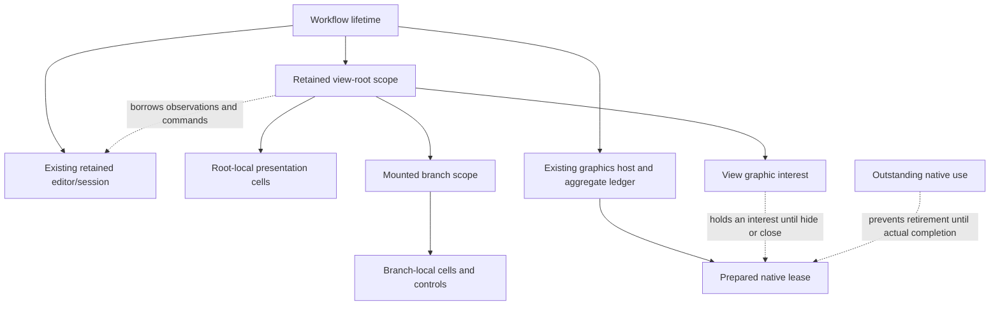
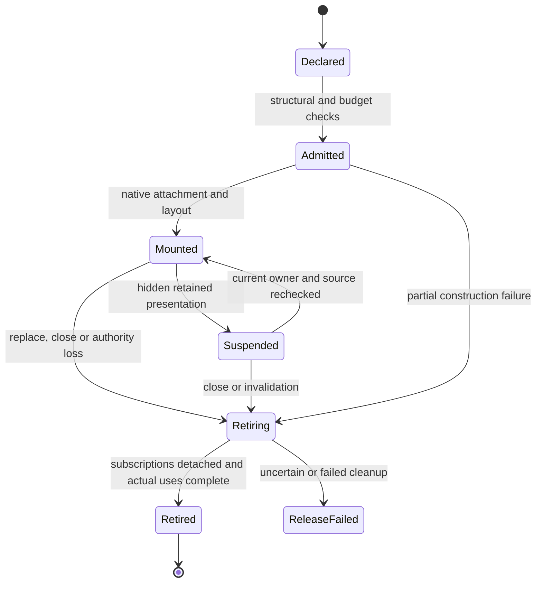

# Declaration, state, and lifetime kernel

This document owns the shared kernel for Designs A and B. Types below are proposed contracts; [API shapes](api.md) and [examples](examples.md) use the same vocabulary. An implementation must adapt existing owner/view/operation services rather than introduce another settings runtime.

## Vocabulary and identity

| Structure             | Identity and owner                                                                            | Input → output; invariant                                                                                 |
| --------------------- | --------------------------------------------------------------------------------------------- | --------------------------------------------------------------------------------------------------------- |
| Definition            | Existing document/type/schema identity; consumer.                                             | Codecs, declared fields and constraints → complete domain values; appearance never changes this identity. |
| Owner session         | Existing actor/context epoch; actual owner.                                                   | Authenticated admitted actions → immutable observations and receipts; aliases share it.                   |
| Component declaration | Authored key, component kind, immutable props and child recipes; author.                      | Typed props/bindings → detached `ViewSpec`; construction has no source/effect work.                       |
| Mounted node          | Root epoch + ancestor component keys + local key + attachment generation; host.               | Admitted declaration → native/control/layout participation; old generation cannot dispatch.               |
| Local state cell      | ViewKey + component scope key + StateKey + state schema; owning scope.                        | Captured initial value and explicit local edits → frozen snapshots; no save authority.                    |
| Field binding         | Existing definition + owner session + exact DraftTarget/native-input epoch; existing actions. | Raw/typed edit intent → identified edit operation; never a raw file setter.                               |
| Read projection       | Scope + source identities/revisions + computation identity.                                   | Cached immutable observations → derived value/availability; pure, bounded, no writes.                     |
| Semantic node         | Mounted node identity and native geometry epoch; derived.                                     | Actual control state + authored relationships → accessible state/actions; no parallel values.             |
| Request               | Existing operation identity + captured input/currentness tuple.                               | Frozen request → outcome and eventual cleanup; navigation identity is not its authority.                  |
| Native use            | Existing prepared graphic/use identity and resource epoch.                                    | Submitted draw/extraction → actual completion/retirement; close is not completion.                        |

The authored key must be unique among siblings and stable across ordinary reflow. A field alias includes placement identity but borrows the same field/session; there is one editable native surface per actual mounted placement and the shared input synchronization policy remains authoritative. Never attach one widget to two parents. Removing a keyed draft row and Undo restores the actual row identity if the existing editor supplies it; a replacement row at the same index is different. Renaming a map key is not permission to reuse its old rendered label as identity.

Root epochs distinguish separate workflow lifetimes. Scope handles are nonserializable and neither portable permissions nor remote request credentials. Return bookmarks contain stable logical identities and bounded value snapshots, not live widgets, closures, GPUs, or owner executors.

## Module and service boundaries

| Layer                       | Proposed responsibility                                                                                                               | Reused boundary                                                                                 |
| --------------------------- | ------------------------------------------------------------------------------------------------------------------------------------- | ----------------------------------------------------------------------------------------------- |
| Neutral presentation core   | Declaration admission, layout inputs/results, identities, semantics descriptions, pure flow reconciliation and value projections.     | Existing presentation/value/edit types; no Minecraft, loader, client classes or optional mods.  |
| Shared physical-client host | Component factories, mounted nodes, native focus/input mapping, Components, cached projections, view state and operation observation. | ClientViewContext, retained editors/workflow, FormPanel and native controls.                    |
| Game adapter                | Widget event differences, font measurement, clipping, immediate drawing versus extraction, narration handoff and renderer shutdown.   | Existing 1.21.1 and26.3 sources; no consumer domain classes.                                    |
| Loader adapter              | Registration, optional dependency/side admission, actual native entry points.                                                         | Existing Fabric/NeoForge services.                                                              |
| Domain owner/provider       | Real values, complete validation, authority, compilation, source resources and effects.                                               | DocumentActions/OwnerContext/OperationScope/ClientGraphicProvider, not a generic node callback. |

Build portable public client entry points in the current Minecraft namespace, neutral types in core, and only real differing APIs in target seams. No new module or dependency is required merely because this table names a layer. Dedicated/common loading must not resolve client semantics, graphics providers, or absent optional classes.

Solid arrows are ownership; dotted arrows are borrowing or retention conditions. Closing a branch does not close the editor. Closing a view interest does not prove lease retirement. Once the workflow/host stops admitting work, its existing native release coordinator still completes the outstanding lease/use lifecycle; it does not recreate an editor or depend on a stopped widget executor.

## Declaration and mounting

A component factory receives immutable props, typed borrowed bindings, and a child scope. It returns one immutable description. Containers own ordered children and placement records; modifiers return descriptions, not mutate mounted siblings. Admission checks duplicate keys/parts, incompatible bindings/definition/source, relationship cycles, invalid geometry, unavailable required capabilities, and complete budgets before source entry or native allocation.

Plain props are construction constants for that component identity; changing values are explicit Read/binding members. The factory's descriptor supplies the plain-prop equality/identity policy, including exact borrowed owner capability identity. Re-declaring the same key/kind with unequal plain props is an actionable declaration refusal, not silent reuse of stale closures. Supply a live Read for changing data or deliberately replace the component key/lifetime. A factory implementation/version change also requires declared compatibility or a fresh lifetime. This keeps mount-once behavior consistent without assuming SwiftUI body reconstruction or magically reactive Java record fields.

Construction pipeline:

1. Capture the factory's declared inputs from cached immutable observations on the native owner thread.
2. Validate the complete declaration; register partial cleanup before entering allocations.
3. Build a detached candidate subtree with logical keys, state references and required component parts.
4. Resolve environment/theme, compute measures and arrangement, and establish current native widgets.
5. Atomically replace the mounted contribution after success. Increment attachment generations for replaced widgets; retained logical keys retain their state cells.
6. Restore focus only after the requested live target is in the mounted tree. Publish the typed REVEALED navigation acknowledgement at that boundary, including reentrant callbacks.
7. Retire old native contributions and resources through their real completion contracts.

A factory failure disposes only its partial contribution, retains the previous usable view when permitted, and reports an actionable declaration/factory error. It neither closes the document nor repeats a prior action. No renderer/source access is performed by metadata admission. Native mount allocation is not domain preparation.

## Lifetime state machine

There is no edge from Retired/ReleaseFailed back to Mounted. A fresh visit creates a fresh attachment. Retiring immediately revokes input/publication, detaches observation/timers and cancels owned demand; it does not stop unrelated owner operations. All cleanups are attempted, their causes retained, and uncertain reservations remain charged. The new component scope owns one hook in the existing context and orders its own child cleanup first, then reverse registration order internally, with idempotent exact-once state. It does not change the existing OwnerContext's public registration-order contract. Native asynchronous release can finish after the scope stops accepting edits. Existing graphics retirement remains authoritative and must not require resurrecting the old owner executor.

Suspension removes native input and disclosed semantic descendants, cancels automatic view demand and retires view-owned graphics. Bounded view-model/input bookmarks may survive. Background owner operations retain their own lifetime and pending/unknown receipts. Resume rechecks READ/currentness, remounts fresh widgets and restores valid focus; it does not implicitly reread sources or reprepare previews. This preserves lazy Home and the existing hidden-preview retirement policy.

## State and binding model

`Read<T>` supplies a cached `Observation<T>`: AVAILABLE with frozen value/revision, or UNAVAILABLE with stable code/reason. It is cheap and does not open an owner. Optional values use an explicit Optional/value shape inside AVAILABLE; unavailable is not null/default/false. `map` and `combine` declare all dependency reads. They propagate unavailable input before running the pure function and record exactly which source revisions produced the result.

`Local<T>` is a captured, bounded, native-thread state cell for presentation preferences such as query, disclosure, inspected key, subject and camera. `Binding<T>` is controlled by an existing authoritative local state or service. Document fields instead use `FieldBinding<T,V>`: a cached field observation and an admitted edit command returning its real OperationHandle. A text field keeps the existing raw native input buffer and input epoch; accepted draft and rejected pre-actor text remain distinct. A failed/asynchronous edit must not snap the control to its last valid typed value or erase a valid sibling edit.

Ownership mode is fixed at construction: controlled value or owned local default. Losing a required controlled read yields unavailable/disabled with reason; it does not switch to an uncontrolled fallback. Programmatic projection refresh emits no user edit. Explicit reset names its baseline. A value change arriving during active local input follows the existing conflict/input synchronization contract, retaining text until deliberately reconciled.

A Local cell belongs to the UiScope that created it: a disposed branch loses its branch-local cells unless an explicit bounded retention policy suspends it. State intentionally surviving branch removal is placed in the retained ancestor view scope and passed down as a binding. Root-view cells survive ordinary route suspension, while closure ends them. Existing field raw-input bookmarks remain owned by the retained editor/input service, not branch-local cells.

Local state has a declared snapshot schema and retention budget. View recreation captures the current retained state, not reruns a default initializer over it. Descriptive declarations contain no serializable lambda state. Immutable source objects retained by projections must not hold closed screens/worlds/registries indefinitely.

## Flow-control primitives

| Primitive                      | Exact behavior                                                                                                                                 | Lifetime and failure                                                                                                                                                              |
| ------------------------------ | ---------------------------------------------------------------------------------------------------------------------------------------------- | --------------------------------------------------------------------------------------------------------------------------------------------------------------------------------- |
| `Show(test, yes, no)`          | Boolean AVAILABLE selects one lazy branch; unavailable selects explicit unavailable feedback. Neither branch factory executes in paint.        | Switching disposes old view scope; session-owned draft/state remains. Explicit `retain` requires a finite state budget and suspension policy.                                     |
| `Switch(cases, fallback)`      | Evaluate cached tests in authored order; first true case wins; duplicate case keys reject.                                                     | Branch identity is case key, not current index. Refuse/flag an ambiguous declared mutually exclusive mode rather than silently change effect semantics.                           |
| `For(items, key, row)`         | Validate entire admitted key vector before reconciliation; preserve row scope/state on move/update, allocate new keys and retire removed keys. | Duplicate/missing keys refuse the new vector and retain prior view with error. No partial key publication. Row updates receive a Read of item, never stale closure-captured item. |
| `Repeat(count, from, row)`     | Fixed-count positional slots for decoration/skeletons; bounded integral nonnegative range.                                                     | Never used for editable persistent rows; changing count retires removed slots.                                                                                                    |
| `Loading(observation, policy)` | Explicit Pending/Ready/Failed/Cancelled projection over an existing operation observation.                                                     | First load has no previous value. A retained previous value is visibly stale and non-current actions are disabled. UI boundary owns observation, service owns request.            |
| `Errored(content, fallback)`   | Catch declaration/projection failures within its view scope and expose cause/recovery. Expected invalid inputs remain typed data.              | Reset re-evaluates view construction only. It cannot retry a write, certify rollback, swallow cleanup failures or turn FAILED effects into success.                               |

Keyed reconciliation is O(n) expected key indexing plus dirty row updates for admitted n. It validates uniqueness and revision before mutation, then applies removal/insertion/move in authored order. If a row factory fails, publish a typed row failure with that stable key and safe repair/inspection rather than shift later values onto it. A source page is not the full catalogue vector; controller paging and key freshness remain explicit. Virtualized recycling creates a fresh attachment generation and restores state by key, never by reused widget address.

## Update scheduling and purity

One native owner turn commits cached observations and local state changes before deriving presentation. Worker completions enter a bounded mailbox; they cannot access nodes, registries or controls. Existing operation services marshal their own actual executor transitions. Shared `UiScheduler` is a host adapter for observation/debounce, not an executor for all mod jobs.

At the update boundary: apply current completion observations; batch local command results; invalidate dependent projections; recompute demanded pure values in dependency order; reconcile affected branches/rows; resolve environment; measure/arrange dirty regions; synchronize native focus and semantics. Rendering/extraction reads that committed snapshot. If publication is asynchronous, retain its revision until the adapter confirms the relevant native boundary; do not infer GPU presentation from extraction.

Writes during pure computation, measure, arrange, semantics, narration, paint or native-use callbacks are refused with a stable diagnostic and retained failure path. An event issues one semantic command. Reentrant completion schedules another owner turn rather than mutating a traversed tree. Callback exceptions after an already acknowledged state change do not invent rollback. Cycles in declared derivations reject the affected projection with a dependency path; loops caused by feedback actions are bounded and diagnosed, not retried every frame.

The pure-phase restriction targets component/document edits and domain effects. Actual native drawing and internal use-ticket/ledger retirement necessarily run at their prescribed renderer callbacks; they remain allowed under existing lifecycle guards and cannot be repurposed as widget/model mutation or domain compilation.

Invalidation categories are CONTENT, INPUT, SEMANTICS, MEASURE, ARRANGE, RESOURCE and PAINT. A query text edit does not invalidate a domain compiler; camera invalidates graphics display but not scene preparation; language/font invalidates captions/measure/semantics but not codec data; resource replacement invalidates source stamps/prepared leases; pure style color invalidates paint/semantics only where contrast/state requires it. Containers propagate child measure invalidation only when their measured offer depends on it.

## Environment and modifier algebra

Environment is immutable, typed, scope-local and borrowed. It includes resolved theme/text roles, locale/direction/font revision, geometry offer, motion policy, and host capabilities. Required service bindings are explicit constructor inputs, not environment-discovered authority. Missing required capability refuses that contribution; optional capability supplies a labelled absence. Environment lookup does not read OS variables/JVM settings or open consumer sources.

Semantic theme precedence remains library defaults → workflow → subtree → component defaults for otherwise unauthored roles → explicit instance patch. `inherit` removes the local override; `libraryDefault` deliberately bypasses inherited role values. Set false/zero/empty is distinct from absence/reset. Modifiers are immutable ordered wrappers: padding changes proposal/content geometry, frame changes constraints, clip changes visible/hit region, background is decorative, theme changes scoped role resolution, semantics adds authored relationships without overriding actual control state. Order is observable and documented; repeated conflicting exclusive modifiers refuse rather than depend on unordered maps.

Parent layout owns placement. Child modifiers cannot take over siblings or duplicate a placement-in-parent record. Responsive arrangement changes container policy while preserving logical child keys, focus/input and state; it does not visit history or open another actor. A portal retains logical environment/authority and uses root presentation geometry under [interaction](layout-interaction.md).

## Resource, cost and extension contracts

Every host admission receives explicit `UiLimits`: declared/mounted node count, depth, relationship/read-edge count, local state bytes, retained branch/row state, pending observation/timer count, text measure cache and semantics snapshot bytes. Limits are separate from legal domain/catalogue bounds. Defaults must accommodate the currently admitted form/catalogue expansions and be measured during implementation; examples receive the host's declared limits rather than invent an unlimited default. Exhaustion produces a complete refusal with the responsible path, no silently truncated control tree.

Cache keys include relevant definition/row/view epoch, source revision, locale/font/theme/width and resource generation. Bounded LRU/weighted caches evict only unpinned observations; prepared/native leases survive until actual retirement. A hidden route retains only its configured bookmark/model budget. Incremental dirty work is proportional to affected dependencies plus changed component rows, not the whole catalogue per paint. Actual latency/heap/frame costs remain implementation measurements.

Extension factories declare kind, required parts, input/output schemas, capabilities, intrinsic measurement, semantic/focus behavior, admission, thread policy, limits and cleanup. They receive restricted bindings and borrowed contexts. No reflective scanning, arbitrary new node kinds from remote data, or escape hatch to raw persistence is admitted. If an extension cannot describe its current value/action/read policy, it remains unsupported rather than decorative proof of a working editor.

These are trusted native-extension contracts, not a sandbox for arbitrary Java. Phase checks can reject writes through re:form bindings/services; they cannot prove that an arbitrary callback never invokes another library or JDK IO. Admission, source review and extension qualification retain that limitation. Remote inputs are bounded data and never instantiate these native factories.
