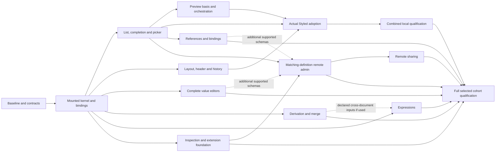

# Migration, work packages, and intent lineage

This is a design-stage migration plan. Existing product/source artifacts remain immutable; no new coordinate, code migration, native run, consumer pin or publication occurs in this goal. [Acceptance](acceptance.md) separates completed design checks from future implementation evidence.

## Existing API/source disposition

| Existing boundary                                                         | Disposition                                      | Proposed replacement/evolution and exact obligation                                                                                                                                                                    |
| ------------------------------------------------------------------------- | ------------------------------------------------ | ---------------------------------------------------------------------------------------------------------------------------------------------------------------------------------------------------------------------- |
| Definitions, ValueType/codecs, DraftNode/Target/Revision, SnapshotContext | Kept.                                            | Exact domains, stable rows, invalid/raw states, freeze and complete validation remain authoritative. No UI key becomes stored schema.                                                                                  |
| DocumentActions/EditorActor/DocumentSession/OwnerContext                  | Kept.                                            | Components use restricted binding/operation adapters; no duplicate draft/history/writer or new authority from a view. Preserve native execution and actual receipt/cancellation semantics.                             |
| FormLayout rows/groups, FormTokens/Geometry, ThemeScope                   | Evolved.                                         | Lower existing declarations into the same measured composition; add real wrap/action/list/disclosure offers and constraint roles. Preserve authored order, theme precedence, numeric domains and default constructors. |
| SettingsView generated field construction and native input cache          | Evolved.                                         | Intrinsic Field parts and explicit per-reference picker contribution share current raw-input/input-epoch machinery. No rebuild-driven reset or private consumer control.                                               |
| ReferenceScreen versus ReferenceTaskView                                  | Replaced duplicated presentation, kept services. | One shared reference controller/component mounted inline, as task or auxiliary host; preserve standalone return/bookmarks and manual IDs. Retire old button-stack/search/preview-specific assembly only after parity.  |
| ReferenceActions/Browser/Selection                                        | Kept and adapted.                                | Reuse source stamps, search/resolve and guarded choose; controller refreshes actual target at activation. Search timing is a UI observation policy, not another resolver.                                              |
| ClientReferenceTask/ClientTaskGraphic flat choices                        | Evolved.                                         | Add contextual picker presentation and typed SubjectForm; old finite choices adapt to one Select control. Existing defaults remain source-compatible where practical; new roles/capabilities are explicit.             |
| ClientFormOptions/FieldEditors                                            | Evolved.                                         | Add typed picker/part/editor declarations on exact definitions/fields. Preserve genuine complex auxiliary editors and current admission/return contracts.                                                              |
| ClientCustomView/ClientViewContent/ViewKey/ViewStateKey                   | Kept and integrated.                             | Factories return admitted shared components inside the same scope. Retained state stays bounded; no Screen-inside-Screen or arbitrary global graph.                                                                    |
| ClientNavigation/WorkspaceNavigation/WorkspaceHeader                      | Evolved.                                         | Same typed routes/attempt acknowledgements and bookmarks; text ancestor links and neighboring native-icon history toolbar, stable shell offer. Preserve reentrant REVEALED actual mount boundary.                      |
| DraftPreviewInput/GraphicRequest/GraphicSourceStamp                       | Evolved with explicit migration.                 | New CapturedGraphicInput sum and GraphicPreparationRequest distinguish draft/audition/loaded. Old draft provider adapter accepts only original draft; audition cannot reuse DRAFT provenance.                          |
| ClientGraphicHost/View/provider/work/ledgers/native leases                | Kept with targeted policy changes.               | Existing aggregate lane/currentness/retirement; preserve camera state on READY, add declared automatic demand adapter and input-basis validation. No private coordinator/renderer/executor.                            |
| Show preview and unconditional Cancel in task controls                    | Retired behavior.                                | Keyboard focus remains accessible; optional accurately named Go to preview only where needed. Cancel readiness follows actual pending/queued/preparing work; drained/ready/terminal inactive.                          |
| Review/Conflict/Import/Operation/close views and Batch                    | Kept services, evolved component presentation.   | Same complete capture/submission, owner scope, whole hidden fields, exact handles and uncertainty; use shared field/actions/status layout without changing effects.                                                    |
| Optional recipe links and native loaded graphics                          | Kept.                                            | View-only capabilities remain optional/side-gated; no mandatory viewer/mod/provider, no audition labelled loaded/draft, no resource manager mutation.                                                                  |
| Documentation and extension examples                                      | Evolved.                                         | Clearly distinguish available APIs from proposed design; one owning contract, migrated examples and exact native provenance/update obligations.                                                                        |

An implementation may retain deprecated façade constructors for a measured transition, but must not maintain two active implementations with divergent behavior. Binary/source compatibility changes require a deliberate API revision and migration note. Stored formats/defaults/paths and native owner effects do not change merely because the presentation API evolves.

## Dependency-ordered implementation checkpoints

| Package/checkpoint                     | Dependency and deliverable                                                                                                                  | Observable review boundary                                                                                                                                          |
| -------------------------------------- | ------------------------------------------------------------------------------------------------------------------------------------------- | ------------------------------------------------------------------------------------------------------------------------------------------------------------------- |
| A0: source/contract baseline           | Current exact product/source and inherited requirement map, baseline UX failures/captures, normative decisions and compatibility inventory. | Owner can identify changed effects/semantics and retained obligations before code. This design supplies the contract portion, not new native baseline runs.         |
| A1: mounted kernel and bindings        | A0; scope/identity/local state/typed reads/commands, pure phase and declared budgets, intrinsic Field/Disclosure parts.                     | Packaged external example proves stale/disabled/invalid/closed behavior with no owner/effect duplication.                                                           |
| A2: list, completion and shared picker | A1 + existing reference services; embedded/task host, current source queries, explicit accept and ID repair.                                | Real keyboard/pointer/source replacement/reflow with same actor, source and raw input; no preview required to prove choosing works.                                 |
| A3: layout/header/history              | A1; measured rows/wrap/scroll/overlays, stable text path/native arrows, retained logical focus.                                             | Actual wide/compact/short/high-scale/language transitions, same header offers and reachable actions. Can iterate alongside A2 without overlapping source ownership. |
| A4: preview capture and orchestration  | A1/A2 + existing host; explicit audition basis, SubjectForm, automatic demand, camera/fit retention.                                        | Read-only complete-candidate/source/native-input races, latest replacement/drain, actual native use/release and truthful capability/refusal.                        |
| A5: real Styled binding                | Useful frozen A2–A4; owner supplies meaningful copy, Models/Artwork roles, same twelve subjects/compiler/provider.                          | Actual complete Profiles and Appearance journeys and discoverability walkthrough, not merely independent fixtures. No private picker/renderer.                      |
| A6: combined local readiness           | All A packages; affected regressions plus inspected unchanged carry, current docs/examples, reproducible artifacts, final local handoff.    | Exact final original/remapped loaded bytes, all applicable native targets, source/effect and bounded cost/lifetime evidence. No implied publication.                |
| F01–F08                                | The named dependencies in [full system](full-system.md#named-future-packages).                                                              | Each independently reified package has its own public/actual-consumer acceptance; eventual complete system includes every retained obligation.                      |

Useful library candidates should be frozen and consumed throughout A1–A5 once implementation is selected. Coordinate actual shared defects versus domain bindings by repository owner. Checkpoints support review; they do not redefine full selected completion as the first small slice. No additional agents or new recurring tasks are required by this plan.

Dotted edges extend a capability rather than block a useful supported subset. F06 local sharing uses existing import/export and does not require F05; the diagram's F05 edge applies to remote sharing. Existing actor/value services are prerequisite foundations throughout, not new implementations hidden behind the diagram.

## Source/effect migration protocol

1. Inspect the actual consumer definition, owner, serializer/path/defaults, native input and application/reload policies. Record the concrete API delta and exact old input identities.
2. Introduce the shared component behind existing declaration services in one owned library change. Keep unchanged core/backend behavior and current safety checks; do not widen dependency ranges or legal domains to fit a UI.
3. Reproduce the relevant old failure where practical, then exercise corrected interaction and negative cases on a new immutable candidate. A fixture correction is not a product fix; retain attributed red evidence.
4. Consumer owner binds real content through public packaged APIs and checks actual configure/return/save/preview paths. Root does not edit peer production bindings or activate a deferred migration.
5. Review component/state/source deltas to carry unchanged evidence only at its actual scope. Run final changed paths on actual support targets and inspect native images/input/narration separately from compilation.
6. Retire proven duplicated presentation paths, migrate docs/examples and freeze a local handoff with source/binary/runtime identities, reproducibility, checks, limits and pending delivery state. Keep original Maven inputs and consequential evidence.

## Intent lineage and planning ownership

The completed original 0.4 implementation remains completed for its historical selected scope. The new semantic candidate owns Design A's revised requirements and links this document set as its contract. The companion analysis becomes a concise overview/deferred-work ledger rather than a competing detailed specification. A new full-reference intent owns F01–F08 and the complete-system acceptance.

The original two-phase intent is preserved byte-for-byte in task history, then updated with a supersession notice. Its historical Phase 2 text remains retrievable; future requirements are transferred, not marked implemented/complete or discarded. Its phase split no longer owns the current implementation order. The disposition manifest records inherited clauses by source digest/line span and owning contract. Any explicitly rejected scope retains the actual owner decision/source rather than a guessed rejection.

Earlier workspace/composition/reification resources remain antecedents: stable native identity, lazy Home, semantic tokens, A-preferred responsive layout, actual owner scope and all 38 original cases remain. Superseded button stacks, boxed crumbs, flat-only preview selection and camera resets are replaced explicitly. Source/ABI changes do not rewrite historical native evidence.

Relevant independent work stays separate:

- Evolving Compat 0.4 adoption refreshes useful current immutable inputs when its owner selects it; its staged repairs/runtime program is not this library's implementation prerequisite.
- Skyweave recipe/defaults/admission and prior migrations retain their actual checkpoints and full-basis/native authority; no new pin or world work follows.
- Keybind Atlas: Listed and Spatial GUI are future stress cases, not runtime dependencies or integrated products delivered by these designs.
- Host advisories retain their separate deferred applicability review; platform classpath hardening is not silently activated.
- RespackOpts, optional illustrated entries/guides, generic server-defined forms, theme-file formats and scene simulation retain their parked/excluded/unresolved status. Named future packages do not authorize their implementation by association.

## Tooling and maintenance contracts

Implementation documentation must include a minimal generated-form path, explicit customization path, component behavior/parts tables, data/effect ownership, native adapter/update checklist and unsupported extension results. Designers and consumers need a bounded read-only semantic/layout inspector, source/currentness views and exact diagnostics; no hidden developer action bypasses admission. Prefer one source of dependency/target/candidate data rather than duplicate launch policy in examples.

Changes to widgets/input/narration, GUI scaling/fonts, resource reload, native serializers, registries/codecs, Brigadier, extraction/use completion, optional providers, selected expression providers or transport require targeted renewed qualification. Preserve API/schema/wire/context version distinctions. Native frame/extraction, pixels/presentation, callback time/GPU/heap, narration data/audio and source/refusal observation remain separate claims.

No new runtime build/probe is necessary to format or verify this design. Proposed examples remain clearly labelled until implemented. Design validation checks links, cross-document vocabulary, required case coverage, source identities, consistency of adversarial sequences and actual repository diff scope. Future product tests cannot be marked passed by this document checker.
