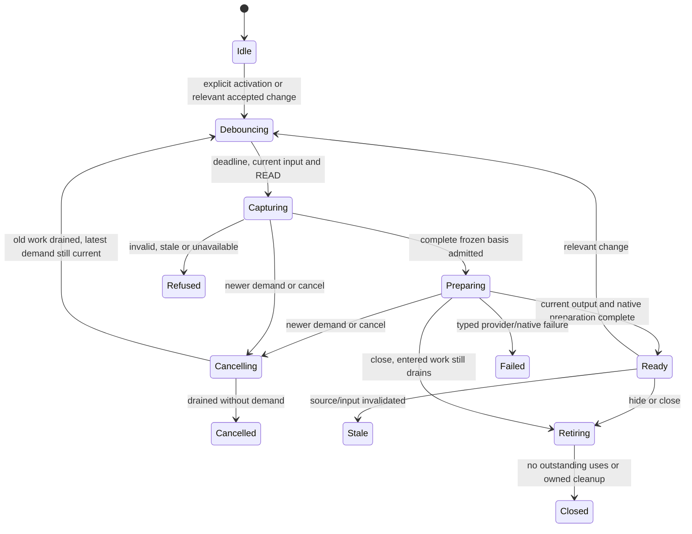

# Shared reference tasks and truthful previews

## User-facing journeys

Appearance answers “Which models and artwork should this draft use?” Models and Artwork each expand an inline picker with a bounded list, automatic search, inspection, optional manual ID, and preview. The field role is fixed. Clicking/Enter on an option stages that one field through the existing guarded edit and creates normal history; arrow focus, hover and search do not edit. A successful accepted edit may trigger automatic draft preparation. Save and reload remain separate explicit actions.

Profiles answers “What profiles are available, and what would one change?” It uses the same catalogue/list/inspection/preview controller, with an explicit audition role: Models by default, or Artwork. Active row inspection may audition after debounce without staging. Visible actions “Use for Models” and “Use for Artwork” explicitly stage their actual fields. Preview basis says “Trying <profile> for Models/Artwork” or “Current draft”; it never implies a highlighted row is already chosen. Contribution counts are inspection facts, not eligibility gates; resolved-empty and inherited profiles remain valid.

In Profiles, list click/Enter accepts a pinned inspection/audition only; it never calls the document choose action. In Appearance, list click/Enter accepts the fixed role's actual guarded field edit. This is a declared difference in the list's acceptance binding, not a different component or guessed event handler. The task separately observes the current raw/accepted Models and Artwork values by role, so a pinned audition cannot masquerade as either staged field.

Search, available profiles, selected details and preview belong to one named container. At wide offers the list and preview can be adjacent; compact mode stacks/focuses the same task with retained bookmarks. Appearance's compact list defaults to about four visible rows plus scrollbar/search, not four admitted results. No full-screen transition is required for ordinary field choice. A genuinely complex future editor may use an admitted auxiliary view with the same return/owner semantics.

Subject controls are container Select/list, Looted checkbox, and Open checkbox, mapped by the consumer to the same twelve combinations. These are view state, not settings fields. A source capability may mark pose unavailable/no visible native motion with explanation. Static reference-lighting/CEM limitations remain visible; no rig animation or world-shader parity is promised.

Lack of visible native lid geometry is a display capability fact, not proof that the consumer's valid Open subject value is illegal. Keep all valid twelve combinations representable and disclose when Open has no visible effect; disable/refuse only a genuinely unsupported subject capability under its actual domain contract.

## Reference controller

One `ReferencePicker<T,V>` controller borrows an existing ReferenceBrowser/ReferenceActions and retained editor. Its presentation can be embedded or mounted as a registered task. It owns query/local inspection/disclosure/view anchors, observation of current searches/lookups, and typed edit intents, but no catalogue discovery service, executor, writer, comparison backend, or duplicate actor.

Controller state contains source ID/stamp; query text/caret/selection and query generation; current page/cursor/completeness; active option, inspected resolved key, and cached current raw/accepted field observations keyed by role; manual raw ID/input epoch; disclosure; independent list/detail anchors; role; and task attachment. `active`, `inspected`, each role's `accepted` and `missing requested` are distinct keys. Source replacement clears resolved admission, preserves requested raw/query text, and labels old facts stale; it never selects a new first option automatically.

Requests bind `(root/view epoch, source stamp, query generation, query/cursor/limits)` or `(source stamp, lookup key, lookup generation)`. Only the matching latest completion can publish. Old operations are cooperatively cancelled/drained through existing services. A late old failure cannot replace a newer READY page. Permission loss clears disclosed facts and refuses new search/choose until fresh admission. Empty page, no matches, incomplete enumeration, unknown key, unavailable source and rejected lookup are separate states with safe retry/refresh instructions.

Search uses the200ms policy, Enter flush and one replaceable pending query. Cheap cached filtering can finish without a worker; actual resource lookup stays in its declared service. The UI must not recreate a catalogue or compile assets on every keystroke. Paging retains opaque source cursors only while that exact stamp/query remains valid. Invalidated cursor causes a clear restart using the same query/selection; never continue another generation's page silently.

The 0.4 list realizes admitted pages plus a bounded overscan; row count/scroll height and source limits are separate. Known total is announced only if the source supplies it. A missing selected item remains a distinct retained requested value with repair action, rather than disappearing from the setting. Long titles stay readable in a wrapping inspection heading; row summary is concise and full label/ID are available without duplicate narration.

## ID completion and explicit acceptance

The manual ID field uses free-form completion. Suggestions are drawn from the same admitted source keys/titles and stamp. Typing preserves exact raw characters, native selection/caret and malformed/unknown input. Editing does not automatically resolve every partial value; completion query and explicit inspection have separate outcomes. Down/Up move the popup's active suggestion, Enter/click accepts that exact suggestion into the input, Escape closes the popup, and ordinary field commit uses the current owner edit. Blur does not accept a highlighted suggestion. A confirmed list option can directly request the guarded field edit; completion acceptance by itself follows the declared field commit policy and does not save.

Before acceptance, verify attachment, current READ, source stamp, resolved item key and exact current target/input epoch. `ReferenceSelection.chooseFromBrowser` is the existing staging boundary; the shared controller refreshes/captures the current field target at activation rather than reusing a constructor-time stale DraftTarget. The actor still serializes/refuses actual edits. If a later edit wins, report stale selection and preserve raw input. A known suggestion list never narrows the actual ID codec domain.

## Preview input types and admission

Current `DraftPreviewInput<T>` and `GraphicRequest.Stamp` truthfully identify a complete current draft. Audition must not replace their candidate while keeping a DRAFT stamp. Add a typed input sum at the shared preparation boundary:

- `CapturedDraft<T>`: the existing complete candidate, PreviewInputStamp, source provenance and observed reference stamps.
- `CapturedAudition<T>`: the same base capture plus exact target FieldPath/ValueType/source, role, resolved profile key/source stamp, bounded transformation identity/version, resulting frozen complete candidate and content digest. The base and transformed candidate are both attributable; neither grants WRITE.
- Loaded-resource requests retain their existing distinct input/source kind. They do not pretend to have a draft or audition.

Both designs use this `CapturedGraphicInput<T>` contract. An evolved preparation request exposes the complete candidate plus explicit basis. Old providers that accept only DRAFT keep a source-compatible adapter for draft requests and report audition unsupported until their owner opts in; no wrapper silently lies about kind. Update SceneData/result/inspection/native input-stamp comparison consistently. This is a public contract migration, not a private mutation of the current record.

Audition capture protocol, all through the existing actual owner/capture lane:

1. Synchronize the mounted field inputs. Reject pending or rejected native text with the exact input epoch, retaining every sibling. Check READ/lifetime/resource availability.
2. Capture the whole current accepted draft at exact DraftRevision, saved baseline/source context and native input stamp. Require its existing complete preflight; invalid required siblings remain refused.
3. Recheck the inspected reference's source/lookup stamp, target type/role and resolved key. Obtain the target's declared encoder; profile IDs are not arbitrary raw patches or reflective setters.
4. On a bounded worker, create one ephemeral immutable draft copy, replace only the declared field value, then run the same complete definition/domain validation and required read-authorized owner preparation as the existing capture path. Do not publish/edit the actor, initialize files, seed packs, create a new session/writer, or return a commit proposal. Any internally needed proposal is discarded within capture and never exposed as commit authority.
5. Freeze the complete result and basis stamps; recheck actual READ, base DraftRevision/input epoch, reference/source/resource stamps and target attachment before delivery.
6. Provider/native preparation and publication repeat currentness checks against the full basis. A later draft/input/source change invalidates both a draft and any audition based on it.

Capture failure returns stable typed unavailable/invalid/stale/refused facts. It does not fall back to the saved/loaded configuration while showing “Draft preview.” Overlay validation is not an automatic repair of an invalid base. A user can explicitly choose/edit the field and request a valid preview instead. Complete owner policies remain authoritative and domain preparation is never called from paint.

## Automatic request and replacement policy

| Event                                            | Default 0.4 behavior                                                                                                                                       | Effects excluded                                             |
| ------------------------------------------------ | ---------------------------------------------------------------------------------------------------------------------------------------------------------- | ------------------------------------------------------------ |
| Open Home or an unopened picker                  | Show cached purpose/available declarations; no domain prepare.                                                                                             | Owner/resource discovery or file creation.                   |
| Enter preview task/return from hidden Home       | Show explicit “Prepare preview” when no current output.                                                                                                    | Automatic entry/return compilation.                          |
| Accept container/Open/Looted state               | Mark requested basis immediately; coalesce latest preparation after 120ms if automatic policy enabled and input accepted.                                  | Setting edit or persistence.                                 |
| Inspect resolved profile or switch audition role | Capture explicit audition basis and enqueue latest request after 120ms.                                                                                    | Staging the profile.                                         |
| Accepted draft field edit                        | Invalidate output; if preview was already explicitly activated in this visit and automatic policy enabled, enqueue latest draft/current audition basis.    | Saved-value substitution or auto-save/reload.                |
| Accept profile option in an inline picker        | Stage the actual field, then treat that acceptance as explicit preview activation and enqueue its current complete draft when automatic policy is enabled. | Search/focus acceptance, another field edit, or persistence. |
| Query/caret/hover only                           | Update UI/search; hover never changes pinned inspection.                                                                                                   | Preview compilation.                                         |
| Camera orbit/zoom/reset or viewport resize       | Redraw/refit through the current prepared view and native-use coordination.                                                                                | Provider capture/compilation.                                |
| Resource reload/READ loss/source replacement     | Invalidate current output, cancel/drain, clear or mark stale according to disclosure policy; require explicit Prepare after resources are admitted again.  | Silent stale publication or reload loops.                    |
| Hide/close view                                  | Cancel view demand, release interests, stop input/publication.                                                                                             | Cancelling unrelated owner operations or recreating owners.  |

“Automatic” is an opt-in declaration for read-only providers. It is not a new global effect scheduler. Use the existing host aggregate lane with at most one entered prepare and one latest replaceable demand. A replacement does not enter before the cancelled predecessor actually drains, and old resources remain charged while outstanding uses retire. Search/completion have their own bounded service observation, not this expensive preparation slot. No common-pool or private consumer executor is added.

The host's existing QUEUED/PREPARING/CANCELLING/terminal states remain separately observable. Debounce/capture are task-demand states, not a falsified native host operation. Cancel is active only with cancelable pending demand or queued/preparing work; it clears the latest demand and requests cancellation once. During CANCELLING it is inactive with draining feedback. Ready output being drawn does not enable Cancel. Prepare/Retry is explicit after failure and does not repeat persistence.

Old content may remain visible only with an “Earlier preview”/stale basis label and disabled current-result actions; READ revocation hides it immediately. Default on base/source change is to remove the old image while retaining cause and camera. No stale pixels are advertised as the requested audition. Pending status is available immediately; optional spinner delay does not conceal cancellation readiness.

## Camera, fit and capabilities

`CameraState` belongs to the view's retained local state, independent of candidate/subject cache keys. Store orbit, user zoom, optional pan, and an explicit user-modified flag. On initial successful preparation use provider defaults once. On later output changes retain orbit/zoom; compute a separate framing scale from current bounds/aspect and chosen orbit so changed geometry fits. Reset clears user modifications and uses the current provider's initial camera/fit. Changing provider identity starts a new view/default policy; changing a subject does not.

A degenerate/empty model has a valid empty scene and stable controls/status, not a divide-by-zero fit. Invalid/nonfinite bounds refuse before native allocation. Camera/viewport-dependent native state still waits for earlier submitted uses before mutation as required by existing adapters. UI retention does not waive native-use fences.

Capability facts belong to the provider/subject: native lid geometry, pose support, tint availability, static/reference lighting, world/context requirements and resource generation. The library does not infer them from container names or raw progress. Unsupported custom CEM animation is explicit. The scene remains isolated; no live resource-manager swap, entity/world ticking, shader/atlas mutation, or native borrowed-resource closure is permitted.

## Ownership, failure and budgets

Lootr supplies domain copy/profile facts, exact field roles, existing sources, subject mapping, complete compiler and truthful preparation/refusal. re:form supplies shared picker/controller, UI composition, capture-basis types, input/READ/source checks, scheduling, host/ledger/native use, controls and feedback. Both inline and task views use those services; there is no private consumer viewport or second comparison engine.

Existing GraphicLimits/GraphicLedger remain aggregate across current, preparing and retiring work. Input/decode/geometry/output/native bytes and objects retain their separate accounting. Capture/overlay adds bounded copied-input work and records its charged size before allocation; it does not hide memory in local state. Failed/uncertain cleanup stays charged and preserves the actual cause exactly once; old-interest failures must not overwrite a newer result's state. Removing a view cannot release borrowed game assets or claim renderer shutdown from a timer.

Critical final checks are listed in [acceptance](acceptance.md): all twelve combinations, base-invalid/rejected native input, READ-only/review-required owners, source/permission changes at each stage, rapid replacements, newer success after old failure, camera retention, view hide/return without autoprepare, close with entered work/submitted uses, actual native shutdown, and all relevant source/file/generation side effects. No new runtime evidence is claimed by this design.
